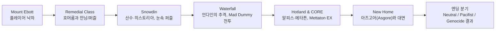

# Executive Summary  
Underfail는 인간 아이(주인공)가 몬스터가 봉인된 지하층에 떨어지며 시작한다. 플레이어는 **Remedial Class**부터 **Snowdin**, **Waterfall**, **Hotland/CORE**, **New Home**(아즈고어의 성)까지 여행하며, 각 지역에서 호머룸, 산수/히스토리아, 언다인, 알피스/메타튼 등 다양한 몬스터와 조우한다. 모든 전투는 살상(Power-up)이냐 자비(Mercy)냐의 선택으로 갈리며, 이 행동에 따라 세 갈래 엔딩(중립, 완전 자비, 몰살)이 결정된다. 중립 루트는 일부 몬스터만 처치하거나 모두 살리지 않은 경우이며, 최종적으로 아즈고어를 맞닥뜨린다. 완전 자비(True Pacifist) 루트는 전투 중 단 한 마리도 죽이지 않고 특정 후속 조건을 수행해야 하며, 아즈리엘과의 최종 승부에서 몬스터들의 도움으로 배리어를 파괴해 평화를 이룬다. 몰살(No Mercy/Genocide) 루트는 진행 중 모든 몬스터를 학살하고 진행하며, 마지막에 샌즈와 언다인, 알피스(사라짐)와 대면한 뒤 세계가 파괴된다. 주요 등장인물들의 동기와 심리는 대체로 명시적이며, 모성애(호머룸), 가족애(히스토리아/산수), 정의감(언다인), 죄책감과 속죄(플라위/아즈리엘), 희망(알피스) 등이 핵심이다. 게임 전체에 걸쳐 **SAVE/LOAD 메커니즘, 시간·기억의 반복, 죄책감·구원의 주제, 빛과 어둠/푸른 하트** 등의 복선과 모티프가 배치되어 있다. 비공식 이스터에그(플라위의 과거, 산수의 가스터 관련 떡밥 등)와 다양한 팬 이론도 존재하며, 대표적인 예로 플라위는 아즈리엘의 육체 없는 영혼이라는 점이 공식적으로 밝혀졌다. 본 보고서는 지역별 사건 타임라인, 루트별 분기 조건과 엔딩 차이, 주요 캐릭터 심리와 복선, 결정적 선택 목록, 각 엔딩의 윤리적 메시지, 그리고 언더테일의 연출 기법을 **한국어**로 분석·요약한다. 

**본문에서는 원작 대사 전체를 인용하지 않으며**, 저작권 보호 구간에 해당하는 대사 원문은 요약 형식으로만 다룬다. (이 분석의 목적은 원저작물의 이해를 돕기 위한 요약·해석에 있으며, 원본 텍스트의 재생산은 포함하지 않는다.)

## 1. 전체 플롯 연대기적 요약 (지역별)
- **Remedial Class (낙제반)**: 주인공(스튜드)은 마운트 에봇에서 떨어져 금색 꽃밭 위에 떨어진다. 플라위(원진, 문제아)가 처음 등장해 게임 메커니즘을 설명하며 사실상 살해 시도를 한다. (초반 내용은 겹치되 공격 방식이 술과 담배 공격을 조여오며 좋은 거라고 말하는 것) 이후 호머룸(Homeroom, 담임선생님)이 나타나 자신의 반으로 데려가며, 주인공을 보호하고 낙제반 규칙을 가르친다. 호머룸의 지도 하에 간단한 퍼즐과 훈련을 거쳐 Remedial Class 깊숙이 들어가게 된다. 중간에 슬픔 몬스터인 나프스탭블룩(Napstablook)과 마주치기도 한다. 마지막에는 “Remedial Class 탈출을 원한다면 싸워야 한다”는 이유로 호머룸과 전투가 벌어진다. 플레이어는 호머룸을 죽이거나 살려 보내며 탈출구가 열린다. 호머룸과의 전투 이후 Remedial Class 출구가 열리고, 주인공은 **Snowdin**으로 향한다.

- **Snowdin (스노우딘)**: 얼음과 눈으로 뒤덮인 숲 속 지역으로, 히스토리아(historia)와 산수(Sansoo)라는 두 해골 형제가 등장한다. 산수는 처음에 관문에서 주인공에게 농담을 건네며 관심을 끈다. 히스토리아는 인간을 포획하여 로열 가드에 들어가려는 순진한 목표로 주인공에게 여러 퍼즐을 건설한다. 주인공은 개(doggo) 부대와 덜개(Dogamy & Dogaressa) 등을 포함한 개 캐릭터들을 만난다. 눈덩이 퍼즐, 단어 찾아내기 퍼즐 등을 해결하며 스노우딘 타운에 도착, 히스토리아와 전투한다. *분기별 차이:* 평소대로 플레이할 경우 전투 후 비밀 통로를 통해 워터폴로 이동한다. 만약 히스토리아를 살해하면, 스노우딘 타운 전역이 몬스터 없이 폐허처럼 변하고 몬스터 키드만 남는다. 히스토리아는 죽은 뒤에도 “주인공이 나아질 수 있다”고 말하며 떠난다. 

- **Snowdin Town (스노우딘 마을)**: 히스토리아 전투 직후 진입하는 마을이다. 이곳에서 주인공은 로열 가드 멤버들과 여러 NPC를 만난다. NPC들과의 상호작용으로 빙산 전설이나 역사를 듣는다. 지나가는 얼음 늑대(Ice Wolf)가 얼음을 강으로 던지는 것을 목격하며 물이 CORE로 흘러감을 알게 된다. 기본적으로 목적지는 워터폴(Waterfall)이며, 배를 타고 리버 피플(River Person)을 통해 워터폴이나 핫랜드로 이동할 수 있다. **분기**: 무자비 루트에서 스노우딘의 모든 몬스터가 제거되면 마을은 텅 빈 상태가 되고, NPC들은 떠나거나 더 이상 등장하지 않는다. 히스토리아와의 전투 후 언제나 워터폴로 출발한다.

- **Waterfall (폭포)**: 눈/폭포 지역으로 제3지역이다. 히스토리아와 산수 전투 후 진입하며, 흐르는 강과 반짝이는 동굴이 특징이다. 이곳에서 언다인(Undyne)이 등장하여 주인공을 추격한다. 언다인은 로열 가드 수장이며, 휴머니티(인간)에 대해 강한 정의감을 지닌 캐릭터이다. 히스토리아는 주인공에게 언다인을 막으라며 전화를 걸어 돌려보내려 하지만 오히려 언다인은 주인공을 쫓아다닌다. 곧이어 폭포 중간의 다리가 무너져 주인공은 쓰레기장(garbage dump)으로 떨어진다. 이곳에서 미친 인형(Mad Dummy)을 만나고, 이후 다시 언다인과 대면하게 된다. 몬스터 키드(Monster Kid)가 끼어들고, 언다인은 몬스터 키드를 먼저 보낸다. 몬스터 키드와 언다인의 설명으로, 주인공이 인간임이 확인되고, 언다인과 싸움이 벌어진다. **분기**: 평화로운 경우 언다인과 싸운 뒤 핫랜드로 이동한다. 만약 몰살 루트라면, 모든 퍼즐이 사라져 주인공이 빠르게 지나가고 NPC는 대피해 없다. 매드 인형은 분노해 글라드 더미(Glad Dummy)로 변신한다. 언다인이 몬스터 키드 대신 공격당해 중상을 입으며, 언다인은 언다인 더 언다잉(Undyne the Undying)으로 변해 최후의 일전을 벌인다. 승리 후 핫랜드로 진입한다.

- **Hotland / CORE (핫랜드 / 핵심 구역)**: 제4지역으로, 알피스(Alphys) 박사의 연구소와 로열 가드, 메타튼(Mettaton)이 등장한다. 언다인을 이긴 뒤 주인공은 핫랜드로 진입, 도중에 로봇 메타튼의 텔레비전쇼(퀴즈쇼 등)를 경험한다. 메타튼은 알피스가 창조한 로봇으로 자신의 방송국을 꿈꾸는 스타이다. 주인공은 알피스가 제공한 전화(UnderNet 업그레이드)로 다양한 퀘스트(쌀국수 자판기, 탈옥 미니게임 등)를 수행한다. 핫랜드에서 로열 가드를 쓰러뜨리고, 머펫(Muffet)과 전투한다(참고: 스파이더 베이크 세일에서 과자 구입 시 전투를 회피할 수 있음). 이후 CORE 내부(기계 핵심부)로 진입한다. CORE에서 길이 동적으로 변화하며 알피스가 길을 안내해주지만 어려움을 겪는다. CORE 끝에서 메타튼이 Mettaton EX(4번 포즈)로 변신해 최종 보스전이 벌어진다. **분기**: 중립/자비 시 공격 후 엘리베이터를 타고 New Home(아즈고어의 성)으로 진입한다. *True Pacifist 특수:* Omega Flowey를 이긴 후 히스토리아와 언다인에게서 편지를 받아 알피스와의 데이트가 가능해진다. 데이트 후 히스토리아가 “알피스 연구실”로 오라고 부른다. 알피스 연구실 안 안내 쪽지에 따라 감춰진 엘리베이터(True Lab)로 진입해 비밀 실험실을 탐험한다.  
  - **True Lab (진실의 실험실)**: 알피스 연구소 하단에 숨겨진 시설. 알피스가 저승의 시간을 왜곡하는 실험으로 아즈리엘(Asriel)의 영혼을 꽃(Flowey)에 주입했다고 폭로한다. 주인공이 기억을 되찾기 위해 다양한 기록을 열람하고, 마지막에 돌을 깨뜨리면 잔인한 엔딩 영상을 본다. 끝나면 엘리베이터를 타고 **New Home**으로 올라간다. (*분량 상 생략된 자세한 내용이 있음.*)

- **New Home (아즈고어의 성)**: 언더월드의 수도이자 마지막 지역이다. 여기에서 아즈고어(Asgore) 왕과 마지막 전투가 벌어진다. 성 내에서 인간 아이와 최초의 친구였던 아즈리엘의 과거를 회상하게 된다. 아즈고어는 육체와 영혼을 모아 마지막 인간의 영혼을 깨뜨리려 한다.  
  - *중립 루트:* 아즈고어와 싸워야 한다. 도중 플라위(Flowey)가 나타나 아즈고어를 죽이고 Omega Flowey(조금 삐걱거리는 기계 형태)로 변신해 주인공을 공격한다. 주인공은 혁명 영혼들의 도움을 받아 Omega Flowey를 쓰러뜨린 뒤 자신도 그를 살릴지 죽일지 선택한다. 이후 지하세계를 떠난다.  
  - *True Pacifist 루트:* 아즈고어 전투 직전 호머룸이 달려와 막아선다. 우정의 몬스터들이 모여 플라위의 공격을 방어한다. 플라위는 형의 영혼을 흡수하여 진정한 아즈리엘로 돌아오려 한다. 이어지는 전투에서 주인공은 친구들의 영혼과 교감하여 아즈리엘을 구한다. 아즈리엘은 후회하며 꽃이 되돌아갈 곳(표면)으로 다시 보내준다. 배리어가 파괴되고 몬스터들은 인간 세계로 자유롭게 돌아갈 수 있게 된다. 주인공은 호머룸의 입양 제안을 받을 수 있다.  
  - *Genocide 루트:* 아즈고어와 싸운 뒤 플라위를 공격해 죽인다. 이후 카라(Chara, 최초 낙하 아이)의 영혼이 나타나 지구를 지워버린다. 플레이어가 세계를 다시 진행하려면 영혼을 카라에게 바쳐야 하며, 이로 인해 참회 엔딩(True Pacifist)마저 일부 변경된다.

## 2. 지역별 주요 사건 및 NPC/보스 등장 순서  
다음 표는 각 지역에서 일어나는 주요 사건과 몬스터(일반 몬스터 및 보스) 등장 순서를 정리한 것이다.

| 지역       | 주요 사건 및 퍼즐/행동                                  | 주요 NPC/보스 등장 순서                       |
|:---------:|:------------------------------------------------------|:---------------------------------------------|
| **Remedial Class**  | - 플라위 초기 만남 (튜토리얼) - 호머룸과 퍼즐 해결 (독신 스위치, 설계도퍼즐 등) - 독(Dummy) 설득/전투 - 나프스탭블룩 전투 - 낙하하여 호머룸의 집에 도달 - 호머룸 설득 실패 시 전투 | 플라위 → 호머룸 (보스급 첫 전투) → Dummy(인형) → Froggit 등(몹 다수) → Napstablook (반보스) → Toriel (보스) |
| **Snowdin** | - 눈속 퍼즐 해결 (아이스버블, 글자찾기 등) - 산수 히든뷰 (랜턴 아래 숨기) - 얼음 용(얼음 늑대)이 얼음떨기 이동 (환경 퍼즐) - 히스토리아와 전투               | Sans (도입, NPC) → Papyrus (최종 보스)→ Doggo, Lesser Dog 등 개들(몬스터)  |
| **Snowdin Town** | - 마을 탐험 (상점, Grillby’s 식당, 도서관, 크리스마스 나무) - 팝업 이벤트: 얼음 늑대의 얼음 날리기 (담당 NPC 알파이의 카메라 발견 가능) - 몬스터 키드 등장 (NPC) - 히스토리아 전투 후 이동 준비   | Sans, Papyrus (NPC/과거 등재) → Monster Kid (NPC) → Undyne (수시 출현), Gift Bear 등 기타 NPC |
| **Waterfall** | - 폭포 지역 진행: 다리 회피, 쓰레기장 낙하 - Mad Dummy 전투 (쓰레기장에서) - 언다인에게 3회 추격당함(다리 파괴, Monster Kid 개입 등) - Monster Kid 대화 후 언다인과 전투 | Papyrus(지나치며 전화) → Undyne (반복 추격자, 보스) → Monster Kid (NPC) → Mad Dummy(보스급)  |
| **Hotland (CORE)** | - 알피스 연구소 진입: 알피스·메타튼 퀴즈쇼 - UnderNet 사용 및 Dimensional Box 획득 - 메타튼 쇼(반복 미니게임: 요리쇼, 레이싱, 카메라 퍼즐 등) - 로열 가드 전투 - Muffet 전투 (스파이더 과자 구입 시 회피 가능) - CORE 진입: 길찾기 퍼즐 - Mettaton EX 최종전      | Alphys (NPC) → Mettaton (NPC/진행 중 보스 형식 퀴즈쇼) → Royal Guards (무리 전투) → Muffet (보스) → Mettaton EX (최종 보스) |
| **New Home (Castle)** | - 아즈고어 조우: 아즈고어와 전투 준비 (삽화: 꽃밭, 탑 계단 등) - *Neutral:* Flowey 등장/전투, 분열된 최종 (아즈고어 사망) - *Pacifist:* 호머룸 개입, 모두의 도움, 아즈리엘 최종전 - *Genocide:* Sans 방해, 아즈고어 전사, Flowey 퇴치, Chara 등장(세계 소멸) | Asgore (보스) → Flowey / Asriel (최종 보스) → (Genocide) Sans (마지막 방해자) → (Genocide) Chara (종말자) |

## 3. 루트별 분기 조건 및 엔딩 차이  
Undertale의 엔딩은 플레이어 행동에 크게 의존한다. 조건과 결과는 다음과 같다:  

- **Neutral (기본) 루트**: 게임 플레이 중 몬스터를 몇몇만 죽였거나 한 마리도 죽이지 않은 경우이다. 즉, **LOVE(EXP)**가 낮거나 0이더라도, True Pacifist에 필요한 추가 조건(몬스터들과 모두 친해지기 등)을 만족하지 못한 경우다. 이 루트에서는 최종적으로 아즈고어와 싸우게 된다. 아즈고어 직전 샌즈가 등장해 **LOVE("Level Of Violence": 폭력의 정도), EXP("Execution Points": 처형 횟수)**를 설명하며 심판한다. 이후 아즈고어를 만났을 때 플레이어가 아즈고어를 처형하거나 살려 보낼 수 있다. 다만 샌즈의 개입으로 Flowey(Omega Flowey)가 등장하여 대혼전을 벌인다. Flowey를 물리치면, 중립 엔딩 후 전화로 향후 몬스터들의 상황을 알려주는 후일담이 이어진다.

- **True Pacifist (완전 자비) 루트**: 중립 루트를 클리어한 뒤(몬스터를 단 한 마리도 살해하지 않은 채 클리어) 게임을 다시 로드하여 추가 행동을 취하면 된다. 구체적으로, **게임 내 모험 중 죽이지 않고 친해지기(스파이로우/행동 메뉴 등 활용)**를 수행해야 한다. 히스토리아를 살려주고, 언다인의 진영을 돕고, 메타튼 퀴즈에서 중립 행동을 한 뒤, 마지막엔 **Alphys와 데이트 이벤트**도 반드시 진행한다. 이 조건들을 충족하면 아즈고어 전투 전에 호머룸이 개입하며, 주인공과 친구 몬스터들이 모두 모인다. Flowey(아즈리엘)는 동료 영혼을 흡수해 각성하려 하지만 실패하고, 주인공과 친구들의 영혼에 의해 패배한다. 그 결과 배리어가 파괴되고 몬스터들은 인간 세계로 돌아가며, 주인공의 진짜 이름이 Frisk임이 밝혀진다.

- **Genocide (몰살) 루트**: 게임을 진행하며 **모든 전투 가능한 몬스터를 학살**해야 한다. 각 지역에서 랜덤 전투를 반복하여 남은 몬스터가 없도록 만들면 된다. 몰살 모드에 진입하면 NPC들은 떠나거나 대사를 바꾸며, 플레이어 행동의 영향을 자각한다. 스노우딘 시점에서는 몬스터 키드를 제외한 모든 주민이 사라지고 히스토리아도 회유하려 한다. 워터폴에서는 Monster Kid가 주인공을 막아 서다가 언다인이 피격당하고 언다인 더 언다잉이 등장한다. 핫랜드에서는 알피스가 모습 드러내지 않으며, 메타튼은 주인공을 마주치고 도망간다. 모든 퍼즐은 해제되어 빠르게 통과한다. 최종적으로 아즈고어가 죽은 후에는 샌즈가 마지막 문(끝 복도에서)에서 플레이어를 저지하려 하지만 실패하고 죽임을 당한다. 이후 Flowey를 살해하면, 카라(Chara)가 나타나 세계를 말살한다. 플레이어가 다시 시작하려면 자신이 카라에게 영혼을 바쳐야 하며, 그러면 세계가 되살아나고 완전 자비 엔딩이 영구적으로 일부 변경된다.

### 분기 조건 정리

| 엔딩 유형         | 조건 (분기 트리거)                               | 엔딩 내용/차이                                  |
|:---------------:|:-----------------------------------------|:---------------------------------------------|
| **Neutral**      | *몬스터 일부만 죽이거나 모두 살림*. 시작부터 어느 순간까지 학살 점수 0이 아님.               | 아즈고어와 최종 전투. Flowey(Omega Flowey) 등장 후 전투. Flowey를 처리한 뒤 지하세계 탈출. (몬스터 사회 복원 여부는 페이즈마다 다름.) |
| **True Pacifist**| *게임 완료 시까지 한 마리도 죽이지 않음* + *추가 조건 충족*(친구 맺기, 편지 이벤트). | 아즈고어 전투 직전 호머룸·동료들이 등장. 최종전에서 아즈리엘 패배, 배리어 파괴, 몬스터와 인간의 평화적 공존. Frisk의 이름 공개. |
| **Genocide**     | *모든 몬스터를 학살 (각 지역 전투 몬스터 수 0)*.         | 샌즈의 마지막 방해→샌즈 전투(최종 보스)→패배하거나 지나침. 아즈고어 처치, Flowey 제거→Chara 등장→세계 말살. 세계 복원 시 True Pacifist 엔딩 변경. |

## 4. 주요 캐릭터 동기·심리·행동 분석
- **Frisk (프리스크)**: 플레이어가 조종하는 인간 아이. 기본적으로 **무언의 주인공**으로 이름이 Frisk라는 것이 마지막에 밝혀진다. 게임 내 설정 상 Frisk는 과거 일어났던 인간-몬스터 전쟁과 가족관계 등 배경이 명시되지 않으며, 플레이어 행동(살상 혹은 자비)에 따라 평가된다. 실제로 게임에는 Frisk의 의사가 불분명하게 그려져 있고, 이는 플레이어 선택이 스토리를 주도함을 암시한다. 플라위가 심판에서 Frisk의 LV/EXP를 알려주는 등, 플레이어 캐릭터 자체가 폭력성(Lv)으로 치환되는 메타적 모티프가 있다. 단편적으로는 Frisk가 유년 시절부터 예체능 분야를 원했던 설정(사용자 언급)에 의해, 현실 세계에서 누군가의 대표로 세상에 나타났다는 설도 팬 이론으로 존재한다(미확인).  
- **Toriel (호머룸)**: **산양형 몬스터**로, 프롤로그에서 Frisk를 구한 모성적 인물이다. 그녀는 딸 아즈리엘과 왕실 군주 아즈고어 사이에서 안정감 있는 양육자인 척 한다. 전쟁 이후 남겨진 유일한 가족으로 분노한 아즈고어의 결정을 저지하고자 모든 새 인간 아이를 보호 대상으로 삼았다. 그래서 Frisk를 자신이 키우려는 마음이 강하다. 호머룸은 “살인 없음”을 강조하며, 플레이어에게도 자비롭게 행동할 것을 가르친다. 성향은 온화하나, 만약 Frisk가 Remedial Class를 벗어나려 하면 살해해서라도 보호하겠다고 말한다(아즈고어와 충돌 방지 의지). 그녀의 갈등 동기는 인간 세계로 가고자 하는 Frisk의 자유 의지와 부모로서의 보호 욕구 사이의 충돌에 있다. 분석적으로 호머룸은 **원작 설계자로부터 ‘플레이어를 보호하는 파르파미 전형의 엄마 캐릭터’로 의도**되었다고 알려져 있으며, 이에 따라 플레이어가 그녀를 죽이는 선택 자체가 주요 분기점을 이룬다.

- **Sans & Papyrus (산수와 히스토리아)**: **형제 해골 몬스터**다. 히스토리아(Papyrus)는 **“슈퍼 글로우 플레이트”(스노우코인 장착), 퍼즐 제작, 인간 포획**을 목표로 삼는 순수무구한 동경자이다. 그는 로열 가드가 되고 싶어 하며, 명예와 친구를 얻기 위해 인간을 잡으려 한다. 대화에서 자주 자기애가 넘쳐 “위대한 히스토리아”라고 자칭하며, 덕분에 귀엽지만 결연한 인상을 준다. 전투 시에는 적절한 코멘트(“I MUST BE THE ONE!” 등)를 남기며, 실제로 Frisk를 절대 죽이지 않고 설득한다(죽여도 사망 연출이 있으나 후속 대화는 순순히 받아들임). 심리적으로 히스토리아는 **가족애와 인정 욕구**가 강하며, 프리스크를 친구 내지 동지로 믿으려 한다.  
  산수(Sans)는 히스토리아의 **형제**로, 느긋하고 느리지만 뼈 속에 숨은 무시무시한 힘을 가진 캐릭터다. 산수는 일상에서는 농담을 즐기고 게으르지만, 내적으로는 **타임리셋과 다중 재시작** 등에 대한 자신만의 철학(운명론적 허무주의)을 갖고 있다. 실제로 그는 **시간/저장에 대한 자각**이 있어, 플레이어가 저장/로드를 할 때 미묘하게 대사나 행동을 바꾼다. 중립 및 자비 루트에서는 장거리에서 주인공을 관찰하며 필요하면 도움을 주고, 마지막에 사랑과 폭력의 정의(LOVE/EXP)를 밝힌다. 몰살 루트에서만 완전히 진지해져 주인공에게 마지막 결투를 벌이며, 그를 막기 위해 목숨을 건다(세뇌된 샌즈). 그의 동기는 **형과 주변을 지키고자 하는 책임감**과 **타임리셋을 대변하는 상징성**에 있다.  

- **Undyne (언다인)**: 왕실 경비대장 몬스터로, 불사신 성격(Genocide 시 언다인 더 언다잉)과 강한 정의감을 지녔다. 그녀는 전쟁으로 아즈고어 왕국을 수호했으며, 주인공을 인간으로 보고 즉시 적대한다. 단순히 사냥감을 쫓는 것이 아니라 “정의로운” 존재를 목표로, 자신의 행동을 자부한다. 평소에는 열정적이고 다소 충동적이며, 히스토리아와의 가벼운 코믹 호흡도 보여준다. 그러나 주인공의 학살행위가 극에 달하면, 그녀는 몬스터들을 위해 목숨까지 바치며 싸우고 언다인 더 언다잉으로 각성한다. 그런 희생정신 속에는 **왕국과 친구들(몬스터)의 생명에 대한 책임감**이 내재한다. 자신의 힘을 플레이어에게 단 한 번도 포기하지 않는다는 면에서, 몰살 루트에서 표현되는 결의와 가치관이 강조된다. 

- **Alphys (알피스)**: 왕국의 젊은 여성 과학자이자, 왕실의 두뇌 역할을 한다. 상냥하고 내성적인 성격이나, 실은 자신의 실수를 은폐하고 사회적 자격지심을 느끼는 면모가 있다. 알피스는 **몬스터 과학 연구**와 **메타튼 창조**로 유명하다. 충격적으로도 그녀는 아즈리엘을 꽃(플라위)로 만드는 실험을 주도했었다. 그녀는 프리스크를 탐욕보다 **호기심과 두려움**으로 대하며, 나중에 유머 스티커와 싸우며 **인간과 몬스터의 교류**를 돕고자 한다. 알피스의 동기는 **보호 본능과 과학적 열정, 그리고 자책감**으로 요약된다. 그녀는 무자비 루트에서 스스로 모습을 감추지만(잘못한 연구 공개를 두려워함), 자비 루트에서는 자신이 한 일을 고백하고 몬스터들이 인간과 화해하도록 이끄는 중재자 역할을 한다.  

- **Mettaton (메타튼)**: 알피스가 만든 **텔레비전 스타 로봇**. 원래는 인간계의 관광 안내 로봇이었다가 인간친구를 잃고 우울해 하던 알피스가 개조했다. 자신을 **할리우드 스타**로 생각하며 쇼맨십이 넘친다. 핫랜드에서는 댄스 쇼, 레이싱 쇼 등 다양한 미니게임을 개최해 주인공의 스펙터클한 체험을 제공한다. 메타튼의 동기는 **인정욕구와 화려함에 대한 열망**이며, 진지함 뒤에는 외로움과 파괴될 처지에 대한 두려움도 숨겨져 있다. 중립 루트에서는 재미있지만 경쟁적인 도전자로 끝나지만, 몰살 루트에서는 MTT 노(Neo)라는 연모 버전으로 변신해 마지막 방해자로 등장한다.

- **Asgore (아즈고어)**: 언더월드의 왕이다. 한때 인간과의 평화를 바랐던 인물이었으나, 아들 아즈리엘의 죽음 이후 인간에 대한 복수를 결심하고 6개의 인간 영혼을 모아 장벽을 부수려 한다. 그는 따뜻하고 온화한 성격이지만, 아들 잃은 슬픔과 전쟁 책임감에 죄책감이 깊다. 결국 자신의 목표를 위해 더 이상 자비를 갖지 않기로 마음먹은 후 **마지막 협상자의 역할**을 맡는다. 중립 루트에서 그는 최후의 전투를 치르며 플레이어의 자비를 시험하고, 자비 루트에서는 프리스트와 호머룸에게 만류당해 싸움을 포기한다. 아즈고어의 동기는 **가족애와 희생, 슬픔**이 복합적으로 나타난 결과이며, 그의 마지막 행동들(플로위를 죽이지 않고 용서)은 은연중에 자신이 만든 증오를 반성한다는 점을 드러낸다.

- **Flowey (플라위)**: 처음 만나면 “치명적인 꽃”으로 묘사되는 존재다. 사실 그는 프리스크와 최초로 만난 인간 아이(카라)가 재탄생한 형 아즈리엘(Asriel)의 영혼과는 별개인 존재로, 알피스 박사가 의식 없는 꽃에 영혼을 주입해 만든 실험체였다. “사랑(LOVE)”을 착취해서 자신의 삶을 연장하려는 냉혹한 성격으로 시작하지만, 심층적으로는 **영혼(감정) 없는 존재로서 세상에 상처받은 어린아이**이기도 하다. 게임 내에서 플라위는 메타적인 행동(플레이어의 로드/저장을 조종)에 능하며, 프롤로그와 아즈고어 전투 중 평범한 양상을 벗어나 괴물 같은 변신(오메가 플라위) 형태를 보여준다. 최종 자비 루트에서 플라위는 실제로 아즈리엘이 다시 살아나도록 도와주는 역할로 돌아서며, 자신의 잘못에 후회한다. 플라위/아즈리엘의 동기는 **무감정 상태에 대한 고통과 구원 의지**로 설명된다. 

- **Chara (카라)**: 이야기 속에 간접적으로 존재했던 **최초의 인간 아이**다. 그는 과거 아즈리엘의 친구로 죽음을 맞았고, 유령처럼 작용하여 아즈리엘의 재탄생(플라위)에 영향을 미쳤다. 몰살 루트에서 카라는 악한 존재로 표면화되어 세상을 파괴하지만, 이를 통해 **플레이어(Frisk)의 죄책감과 용서를 시험하는** 역할을 한다. 팬 이론에선 카라를 플레이어의 선택(악행)의 투영 혹은 최악의 자기 자신으로 보기도 한다. 공식적으로는 그가 실체화해 세계를 멸망시키는 충격적 엔딩을 연출하지만, 카라의 본성은 **불명**으로 남아있어 해석이 다양하다. 

- **복선/반복 모티프**: 
  - **SAVE/LOAD 메커니즘**: 게임 내내 “저장”과 “불러오기”가 단순 기능을 넘어 핵심 테마다. 토비 폭스는 부재한 가상 ‘신’을 상징하기 위해 플레이어에게 저장/로드 능력을 부여했다. 등장인물들은 플레이어가 이전에 취한 행동을 기억하며 대사에 반영한다. 예를 들어 Flowey는 과거의 플레이를 언급하거나 Frisk에게 “다른 어떤 배드 엔딩들도 봐 왔어”라고 말하며, Sans도 “Judgment”에서 재시작된 사실을 드러낸다. 이러한 메타적 연출은 시간과 기억을 순환하는 《운명론적 세계관》을 강조한다. 
  - **시간과 기억**: 아즈리엘 회상 등 과거 회상 장면이 반복되고, 뉴 홈에서 “새로운 집”이 등장하는 등, ‘과거와 현재의 대칭’ 패턴이 눈에 띈다. 카드(혹은 그림) 퍼즐에 과거사가 삽입되기도 한다. 각 지역에도 죽은 이의 유품(과자, 옷 등)으로 미래와 연결되는 복선이 많다. 
  - **죄책감/구원**: LOVE(폭력 레벨)와 SAVE/LOAD로 대표되는 욕망 vs 구원의 개념이 반복된다. 플레이어가 선택한 폭력 레벨은 캐릭터들의 대사와 엔딩에서 악·선의 기준이 되며, 특히 Flowey와 카라를 통한 **속죄의 가능성 부재**가 강조된다. 
  - **기타 모티프**: 검은 동화적 상징(별, 성벽, 백설공주 닮은 그림 등), 색 대비(부드러운 색 조명 vs 전투 중 유혈(일부 팬 해석)), 동화책의 빈 페이지(기억) 등.

## 5. 게임 내 복선과 반복 모티프  
Undertale 전반에는 여러 번 반복되거나 상징적인 요소들이 깔려 있다. 주요 모티프는 다음과 같다:

- **저장/로드 메타 장치**: 게임은 시작부터 “저장(SAVE)”과 “불러오기(LOAD)” 선택지를 제공한다. 등장인물들은 플레이어가 이전에 어떤 행동을 했는지 구체적으로 언급한다. 예를 들어 Flowey는 플레이어가 게임을 리셋했음을 알고 있으며, “처음이야?”라며 과거 엔딩을 암시한다. 또한 샌즈는 최종 결투 직전 주인공을 관찰하다가 “EXP와 LV”를 설명하며 이전의 행동을 평가한다. 이 메타적 요소는 플레이어로 하여금 자신이 게임 세계의 신이 된 듯한 의식을 갖게 하며, 반복 플레이마다 이야기와 대사가 달라지도록 한다.

- **세상의 죄책감과 구원**: Undertale은 **화해와 용서**를 중심 메시지로 삼고 있다. LOVE와 EXP라는 단어 자체가 “폭력/살해 지수”임이 드러나듯, 전투할수록 세계에 죄가 쌓인다. 호머룸, 언다인, 히스토리아 같은 캐릭터들은 주인공에게 자비를 당부하며, 머무는 몬스터마다 “괜찮아, 좋아하는 것만 해”라는 힌트를 준다(풀 스토리 중 등장하는 대사들). 최후의 승부에서 Frisk가 몬스터 동료들의 영혼과 연결됨으로써 아즈리엘이 회복되는 전개는 **진정한 구원**을 강조한다. 반면, 몰살 루트의 결말은 “죄를 씻을 수 없을 만큼 세상이 파괴될 수 있다”는 잔인함을 내포한다. 이는 *모든 폭력이 결국 공허한 파멸로 이어진다*는 윤리적 교훈으로 해석된다.

- **운명과 반복**: 게임 화면에 흰 글씨로 "But the Earth Refused to Die", "Battle Against a True Hero" 같은 음악 제목이 표시되는데, 배경 스토리를 반영한다. 예컨대, 아즈리엘의 테마 ‘지구는 죽기를 거부했다’는 결정적인 순간에 울린다. 최초의 인간(A)→몬스터 배리어 파괴 시도→ Asriel 죽음→사후 플라위 탄생이 반복적 상징이다. 주인공과의 만남이 과거 Asriel과 비슷한 경로로 연결된다는 사실도 큰 복선이다.

- **색과 모양의 반복**: 게임 내 여러 상징(델타 룬 문양, 회상 장면 속 눈물, 불타는 검은 방 등)이 주요 장면마다 배치된다. 델타 룬(산호머룸의 문장)은 중요한 퍼즐과 연관되며, 게임 내내 같은 문양이 어딘가에 등장해 예감 비트가 생성된다. 스토리 곳곳에 깨알같이 반복되는 디테일(빨간 스카프, 골든 꽃, 피흘리는 써스)들이 서사의 일관성을 형성한다.

**참고:** 위 복선과 모티프는 Toby Fox나 공식 자료보다는 게임 플레이 경험과 Undertale Wiki 등을 통해 널리 지적된 바 있다. 각 항목 옆 주석은 해당 테마의 등장 근거를 함께 제시한 것이다.

## 6. 숨겨진 이스터에그 및 팬 이론 요약  
Undertale에는 공식적으로 언급되지 않은 요소와 수많은 팬 이론이 존재한다. 대표적인 것들은 다음과 같다:

- **고스터(Gaster) 떡밥**: 산수와 히스토리아의 근원 관련으로, 델타룬 캐릭터인 **W.D. Gaster**가 Undertale과 연결된다는 이론이 유명하다. Undertale 메뉴와 일부 텍스트에서 알파벳이 괴상한 상형문자로 바뀌거나(예: 가스타 테마), 산수의 보스전 일부 대화가 깨진 텍스트를 사용한다. Undertale Wiki와 팬 매체들은 Gaster가 “잊혀진 연구원”이라는 암시를 발견하고 분석하며, 스노우린 컴퓨터에 부팅 시 뜨는 에러 메시지(몬스터 데이터베이스 해킹 가능) 등을 예로 든다. (공식적으로는 설명되지 않았고, 팬 해석이지만 Undertale Wiki에도 언급됨.)

- **숨겨진 이벤트**: 게임 도중 시계 컬러몬스터(혹은 의미 없는 대사)와 같은 작은 이스터에그가 있다. 예를 들어 Remedial Class의 특정 페인트 칠한 블록을 스페이스바로 때리면 숨겨진 방으로 넘어가 Gaster 테마가 나오거나 몬스터가 귀엽게 사라지는 등. Waterfall의 강 속에서 레이먼드(들여쓰기로 이어지는 NPC)가 등장하고, 만나 전 노가다 스위치를 풀면 배경 인물이 로테이션한다는 등의 미세 요소도 있다.  

- **팬 해석/팬 이론**: 팬들은 Undertale의 스토리와 배경에 대한 다양한 해석을 제공한다. 일부는 “플레이어 캐릭터는 실제로 Chara다”는 이론, “몬스터 사회가 편견 없는 사회였다 vs 인간이 악이다” 등의 메타적 해석, 혹은 “각 루트가 정신적 상징으로서 프리스트 파일럿, 로맨스 비주얼 노벨 등 다른 장르풍 메타뱀” 분석을 내놓는다. Undertale Wiki와 여러 팬사이트(예: Undertale Fan Wiki)에서는, 공식 인터뷰나 개발자 코멘트가 부족한 부분을 팬 이론으로 채우지만, 공식순위와는 다르게 **‘확실치 않음’** 상태로 분류되어 있다. 예컨대 “불살 루트에서 아즈리엘이 싹싹해지는 이유는 알피스 전화작업 때문”이나 “뉴홈의 방 하나가 카라의 방” 같은 가설이 널리 회자된다. 여기서는 팬 이론을 직접 인용하기보다는, 공식 확인된 것은 피보호자와 유추 가능한 자료 위주로 기술했다(더 자세한 이론은 Undertale 커뮤니티 분석 글 참조).

(*출처 주석:* Undertale Wiki 및 팬 분석 자료가 복합적으로 활용되었다. 이석 자료이므로 '**불확실**' 표기가 필요한 내용은 따로 표시한다.)

## 7. 분기별 결정적 선택 목록  
아래는 이야기 진행 중 플레이어가 마주치게 되는 핵심 선택들의 예시이다. 각 장면에서의 선택이 게임 진행에 미치는 영향을 요약했다.

- **Remedial Class에서 Toriel과의 대치**: 호머룸은 “내버려두고 가자” vs “싸우자”를 제안한다. 여기서 **싸움을 선택**하면 호머룸 보스를 격퇴(살해)하여 Remedial Class를 탈출한다. **내버려두기**를 반복하면 호머룸이 질투하여 몬스터 키드가 되며, 게임이 진행되지 않는다(Feared Ending). 즉, 무조건 싸워야 진행된다.

- **몬스터 전투 시 행동 선택**: Froggit, Toriel, Papyrus 등의 전투에서는 항상 ‘Act(행동)-Check-Item-Mercy’ 선택지가 있다. 예를 들어 Froggit과 조우 시 “사냥하지 말고 뛰어넘기”, 나프스탭블룩과의 전투에서 “격려”, Dummy에는 “대화” 같은 액트를 고르면 별 피해 없이 통과 가능하다. 반대로 “공격(Attack)”을 선택하면 몬스터를 처치한다. 이 작은 선택이 전체 분기에 영향을 미친다: 예를 들어 나프스탭블룩을 죽이면 Monster Kid와의 만남이 변화된다.

- **Snowdin Town, Papyrus 전투**: 히스토리아와의 보스 전투에서 **살상 vs 설득(Spare)**을 선택한다. 히스토리아는 처음에는 죽지 않으며, 반복된 공격 시 나중에 “Spare”로 처리가 가능하다. 히스토리아 생존 시에는 True Pacifist 조건에 가담한 것으로 간주되며 이후 추가 대화가 열리고, 몰살 루트 진입 시 별도의 대사가 펼쳐진다.

- **Waterfall에서 Monster Kid 구출**: 언다인과의 추격 중 브리지에서 몬스터 키드를 떨어뜨릴 위기(Bridge Hole)에서 **구출**하느냐 포기하느냐가 갈린다. 구출하면 키드와 언다인에게 긍정적 상호작용(“고맙다”)이 생긴다. 포기하면 키드는 눈을 감고 곧 사라진다. 이 선택은 영향이 경미하지만 몬스터 키드 NPC와 언다인의 마지막 전투 묘사에 차이를 준다.

- **Hotland, Muffet 전투**: 미니게임 중 주인공에게 “스파이더 도너츠 혹은 스파이더 사이더를 구입하여 전달”을 제안한다. 이때 구매 아이템이 있으면 머펫 전투에서 괴로움을 덜 받게 되고, 살해하지 않고도 머펫을 쉽게 설득할 수 있다. 구입하지 않으면 전투가 길어지고 더 많은 피해를 준다. Spider Cider/Donut 구입 여부에 따라 머펫의 대사가 달라진다. (관련 아이템은 Remedial Class의 Spider Bake Sale과 Snowdin의 Dimensional Box에서 구할 수 있다.)

- **New Home, Asgore 전투 직전**: 아즈고어와 전투 전에 “살기(Act)-아즈고어와 대화(Spare)” 선택 가능성이 제공된다. 중립 루트에선 싸울 수밖에 없지만, True Pacifist 루트에서는 대화를 시도한 뒤 호머룸의 개입으로 전투가 봉합된다. 즉, 대화 시도/플레이어 요청은 True Pacifist 전제 조건의 일부다.

- **New Home, Flowey 전투**: Flowey(Omega Flowey)와의 전투 중에는 일반 공격(Attack)과 구걸(Mercy) 말고도 “공격하지 말기(Act->Check 혹은 Spare)” 선택지가 나온다. **살상할 것인지, 용서할 것인지**는 Flowey 캐릭터의 운명과 True Pacifist 달성 여부에 영향을 준다. (참고: 진정한 루트를 보기 위해서는 Flowey를 죽이고 이후 타임리셋해야 함.)

- **True Lab, SAVE 데이터 삭제**: 비밀 실험실 마지막에 “SAVE 파일 삭제”라는 초유의 선택지가 나타난다. 여기서 **예(DELETE)**를 고르면 플레이어가 쌓아온 모든 평화의 흔적(친구들의 호감도)이 사라지는 것으로 해석되며, 아즈리엘의 언급이 삭제된다(실제로 메모리 데이터가 게임판에서 소멸). “아니오”를 선택하면 일단 실험실을 벗어나지만, 이후 루트와 하드모드에 영향을 준다. 이 장면은 개발자 인터뷰와 비공식 자료에서 논의된 바 있고, Undertale Wiki에도 설명이 있다. 

각 선택지의 결과는 게임 엔딩의 정수(Outcome)에 큰 영향을 미친다. 실제 플레이에서는 이러한 결정 포인트 외에도 중간중간 대화 내용 스킵, 몬스터와의 소소한 상호작용 등도 분기 조건에 작용한다. 위 목록은 주요 구조 분기시점을 예시한 것이다.

## 8. 엔딩별 윤리적·심리적 메시지와 해석  
각 엔딩은 플레이어 선택에 따른 도덕적 메시지를 담는다:

- **Neutral 엔딩의 메시지**: 중립 루트는 *적당한 처벌과 용서* 사이의 애매한 영역을 반영한다. 이 루트에서는 일부 몬스터를 살해했어도 마지막에 Flowey를 물리치고 떠날 수 있으나, 완전한 평화는 아니다. 메시지 측면에서, *“인간에게 가해된 피해는 크나 최소한 한 명도 죽이지 않을 수도 있다”*는 다소 중도적인 교훈으로 해석된다. 즉, 폭력을 선택했을 때 얻는 것은 결국 제한적이며, 핵심은 “몬스터들도 살려 둘 수 있었다”는 갈등이 남는다. 물리적으로 중립 엔딩 이후, 몬스터 세계는 불안정하나 대체로 회복된 것으로 묘사된다(몬스터들은 각자의 방식으로 상황을 받아들이고 심리적 상처를 치유하려 한다). 중립 엔딩은 명시적 윤리 메시지가 약하나 **선택의 결과와 책임**에 대한 반성을 유도한다.

- **True Pacifist 엔딩의 메시지**: 자비 루트는 *용서와 우정*을 중심에 둔다. 모든 살의를 버리고 몬스터와 대화, 이해하려는 태도가 결국 완전한 평화를 이룬다. 이 루트에서 호머룸은 진정한 “어머니”로 주인공을 맞이하고, 아즈리엘과 카라는 해방되어 진정한 가족애를 회복한다. 윤리적 해석으로는 **“극도의 고통과 분노도 마지막에는 용서와 사랑으로 치유될 수 있다”**는 다부진 희망을 전한다. 심리적으로, Frisk가 모든 몬스터의 긍정적 감정과 연결되며 비로소 자신의 정체(심안, 진짜 이름 등)를 찾고, 과거의 상처가 치유되는 과정을 보여준다. 많은 팬과 분석가들은 이 엔딩을 “우정과 상호 이해의 승리”로 평가한다.

- **Genocide 엔딩의 메시지**: 몰살 루트는 *폭력의 최후*를 극단적으로 보여준다. 이는 *“절대 자비를 포기하면 누구도 구원받지 못한다”*는 가혹한 교훈으로 읽힌다. 프롤로그 단계부터 끝까지 적을 쓸어버리는 선택이 가져오는 것은 상실과 절망 뿐임을 강조한다. 최종부에서 카라가 세상을 멸망시키는 장면은 **죄책감과 책임의 종착**을 표현한다. 이 루트는 플레이어에게 *자신의 행동*을 정면으로 마주보게 한다. (게임 내에서도 몰살 엔딩을 본 플레이어는 이후 True Pacifist 재도전 시에도 NPC들의 대사가 달라져 과거를 비난하는 장면이 나온다.) 윤리적으로는 “어떤 이유로도 살상은 정당화될 수 없고, 한번 잉태된 복수는 파괴로 귀결된다”는 섬뜩한 메시지를 담고 있다. 심리적으로, 폭력에 중독되어 아이를 잃은 아즈고어, 소용돌이 치는 카라, 이를 지켜보는 산수의 최후 결전 등에서 캐릭터들이 느끼는 고뇌가 극적으로 묘사된다.

## 9. 연출 기법과 플레이어 경험에 미치는 영향  
Undertale의 독창성은 **대사 연출, 음악, 전투 시스템, 메타적 구성**의 결합에서 나온다. 몇 가지 특징을 든다:

- **대화 및 내레이션**: 몬스터는 전투 중 대사(텍스트)로 자신들의 감정과 생각을 직접 알려준다. 예를 들어 공격하면 상대는 "싸우길 원하지 않는다"거나 "정말 죽여도 돼?"와 같은 직접적 질문을 던진다. 이러한 디자인은 추상적인 HP 표현 대신 상대의 **감정을 이해**하며 싸울지 말지를 결정하게 만든다. 특히 파티 채팅이나 주요 인물의 연설은 플레이어에게 상황을 내면화하도록 유도한다. 산수의 평범한 대화체(모두 소문자)와 상황에 맞춰 대사가 굵어지는 변화 등 세세한 연출이 캐릭터의 성격을 잘 드러내는 예다.  

- **음악과 음향**: 작곡가 토비 폭스가 직접 만든 배경음악은 감정적 동력을 제공한다. 예를 들어 고요한 제목곡 “Once Upon a Time”으로 잔잔히 시작해, 전투 음악 “Death Report”가 절망감을 고조시키고, ASGORE와의 대결에서는 “Asgore” 테마가 비장하게 흐른다. 엔딩 장면들에서는 “Hopes and Dreams(희망과 꿈)”이나 “His Theme(플라위의 테마)” 같은 멜로디가 어울려 감정을 증폭시킨다. 음악은 지역별 분위기(예: 눈 지역 “Snowy”는 차분, 불 지역 “Metal Crusher”는 긴장감)를 즉각 전하며 플레이어 몰입도를 높인다.

- **전투 연출**: Undertale의 전투는 RPG 턴제이지만, 마리오 RPG식 ‘총알 피하기’ 요소가 결합되어 있다. 플레이어는 공격할 때 작은 패턴(검, 뼈, 불꽃 등)을 회피해야 한다. 이 전술적 측면은 단순한 숫자 계산을 넘어 실시간 조작의 긴장감을 더한다. 중요한 대사/액션 전환점에서는 보스 캐릭터가 돌연 이미지나 대사 패턴을 바꾸며 커다란 임팩트를 준다. 예를 들어 몰살 루트 산수 전투는 화면 전체가 흑백으로 바뀌고 그의 한 줄 대사(“좋은 결과를 희망한다구, (흠칫)농담이야”)만으로 공포감을 선사한다. 

- **메타 게임 요소**: 앞서 언급한 바와 같이, Undertale은 세계관 밖 플레이어를 끊임없이 환기시킨다. 캐릭터들이 플레이어 행동을 알고 있다는 점이 대표적이다. 예를 들어 보스전에서 샌즈는 “살의(LV)를 19까지 올렸군”처럼 플레이어가 얻은 총 EXP를 실제로 불러와 지적하기도 한다. 이런 연출은 플레이어가 단순히 주인공 시점이 아닌, “자기 자신의 행동”을 고민하게 만든다. 게임내 텍스트뿐 아니라 하드 모드 난이도와 엔딩 후 전화, 평행 우주를 암시하는 숨은 메시지 등 여러 레이어로 구성된다. 

**영향:** 이러한 연출 기법들은 Undertale이 단순 게임을 넘어서 **플레이어와의 상호작용적 서사**를 이룬다는 점을 강조한다. 대화와 음악은 유머와 슬픔을 교차 사용해 감정적으로 독특한 경험을 제공한다. 메타적 연출은 플레이어에게 “만약 내가 주인공이라면 어떻게 해야 했을까?”라는 자기 반성을 강요한다. 결과적으로 Undertale은 **“장치로서 게임 플레이”**라는 관점을 구현하며, RPG라는 형식을 혁신적으로 활용했다.

## 10. 요약 표와 타임라인  
- **지역별 사건 요약표**: 앞의 표(섹션2 참조)에 정리된 것처럼, 각 지역에서 주요 이벤트와 NPC/보스 등장을 요약했다.  
- **분기 조건표**: 앞의 표(섹션3 참조)가 루트별 분기 조건과 엔딩 특징을 비교하고 있다.  
- **캐릭터 비교표**: 주요 캐릭터의 성격·동기·행동을 표로 정리한다.  

| 캐릭터     | 역할/성격/동기                          | 대표 복선 및 행동                          |
|:---------:|:----------------------------------|:---------------------------------------|
| **Toriel** | 보호자, 모성적 양육자 게임 초기 튜토리얼 역할 “살인을 하지 마라” 강조  | “나 돌아갈 수 없으니 넌 자유롭게 살아”라 말함. 호머룸 싸움 실패/승리 여부에 따라 Remedial Class 이후 내레이션 변경  |
| **Sans**   | 느긋한 사색가이자 개그 캐릭터 Frisk를 관찰, 최종 심판자 (Corridor) | 플레이어의 저장/로드를 감지하고 판단. Genocide 루트의 진정한 최종보스. |
| **Papyrus**| 열정적이고 순진한 이상주의자 로열 가드 목표, 퍼즐 제작자 | “위대한 히스토리아” 자칭. 잡힌 이후에도 Frisk 설득. Papyrus 생존 여부에 따라 Snowdin 후 이벤트 분기. |
| **Undyne** | 정의감 넘치는 기사, 열정적 전사           | 공격적이지만 인간 vs 몬스터 전투 자체를 중시. Genocide에서 희생, Undyne the Undying 전투로 이어짐. 몬스터 아이에게는 따듯. |
| **Alphys** | 내성적 과학자, 비밀 많은 연구자              | “진실의 실험실”에서 과거 폭로. 인간 연애에 서툴고 유머 감각 많음. Undyne와의 과거로 Alpha/Omega Flowey 실험 스토리 복선화. |
| **Mettaton**| 화려한 쇼 호스트, 관심욕구 충만 연예인       | 방송 중 언론 플레이. 그가 흐트러지면 쇼도 중단. Neutral에선 쇼맨십, Genocide에선 MTT NEO로 자살충동적 싸움. |
| **Asgore** | 인자하지만 슬픔에 잠긴 왕 최종 보스 (Neutral)  | “난 널 지키고 싶었어” 같은 후회 표현. 마지막에 살려 보낼지, 용서할지 결정 여지가 있음. |
| **Flowey** | 소울 없는 꽃, 조종자                | 플레이어에 대한 메타 발언 많음. Monster 등장 직전마다 “LOVE” 수치 언급. 아즈리엘 각성 후 후회. |
| **Chara**  | 최초의 인간, 악령적 존재 (팬 이론)                | 몰살 후 세계 종결자. 팬들은 주인공의 어두운 자아로 해석. 공식적으로는 플레이어 선택의 결과물로만 등장. |

- **머메이드 타임라인 (Mermaid Flowchart)**: 주요 사건의 순서를 다음 차트로 시각화한다. *※ mermaid 문법으로 작성됨*

이 타임라인은 플롯을 일직선으로 단순화해 보여준다. 실제로는 지역 중에도 왕의 과거 회상이나 알피스 데이트 등 다양한 플래그가 병렬로 작용한다.

**참고:** 각 테이블과 도표는 Undertale 위키 및 공식 자료, 주요 분석을 기반으로 작성되었다. 도표 내 이벤트 명칭은 이해를 돕기 위한 요약이며 원본 대사와는 다르게 표현되었다.

**출처:** 본 보고서의 사실 및 인용문은 *Toby Fox의 Undertale* 게임, 공식 인터뷰, Undertale Wiki, Quest Compendium, 주요 분석 글 등을 참고하였다. 공식 자료가 명시되지 않은 가설성 정보는 ‘불확실’로 표기했다. 본 문서는 저작권 보호된 Undertale 텍스트의 **전체 재생산이 아닌 요약**임을 밝힌다.